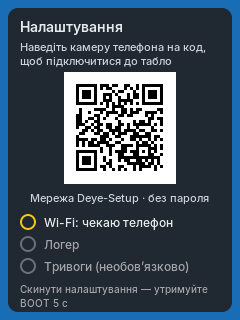
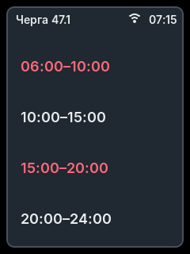

# deye-mini-display

A standalone mini display for **Deye** hybrid inverters with a **Solarman** Wi-Fi logger.
A small screen for the bedside table or the kitchen that shows what matters during power outages:

- **grid power on / off** (and since when),
- **battery charge %** and whether it is charging or discharging,
- the home's **power consumption**,
- an **air-raid alert** for your community (optional, Ukraine),
- the **power outage schedule**: the current interval as a bar at the bottom and the next ones on a second screen —
  Kyiv (by address) and Zhytomyr region (by group), optional.

No Deye/Solarman cloud, no accounts, no tokens: the display reads the logger directly on your home network
and **never writes anything to the inverter** (read-only Modbus function `0x03`).

The on-device interface is in Ukrainian.

| Grid on | Alert, grid off | Setup |
| --- | --- | --- |
|  |  |  |

| Outage schedule (swipe) | No schedule data |
| --- | --- |
|  |  |

> Status: **0.2.9, running on real hardware.** Details: [`docs/PLAN.md`](docs/PLAN.md).

## What you need

- A Deye single-phase hybrid inverter (SG0xLP1 series) with a Solarman Wi-Fi logger answering on local port 8899.
  Three-phase models are not supported yet — the display says so instead of showing wrong numbers.
- A **NiceMCU-32S-DEV 2.8IPS** board (ESP32, 2.8″ 240×320 touch screen, USB-C).
- 2.4 GHz Wi-Fi on the same network as the logger.
- The logger serial number (the "SN" sticker on the logger), in case the display cannot find the logger by itself.

## Installation

### From the browser (Chrome or Edge)

No software to install: the official Espressif flasher runs in the browser —
<https://espressif.github.io/esptool-js/>. It needs **desktop Chrome or Edge** (Web Serial); it does not work in
Firefox, Safari or on phones.

Each [release](https://github.com/AlexMovchan/deye-mini-display/releases/latest) has two files:

| File | Address | When |
| --- | --- | --- |
| `deye-mini-display-<version>.bin` | **`0x0`** | first install, or to start from scratch — settings are **erased** |
| `deye-mini-display-<version>-update.bin` | **`0x10000`** | update — Wi-Fi, logger and other settings are **kept** |

#### Before you start

- Use a USB-C cable that carries data (some cables are charge-only — the port then never shows up).
- The board uses a **CH340** USB-serial chip. If no new port appears when you plug it in, install the CH340 driver
  (Windows: "CH341SER" from the chip maker WCH; macOS 12+ and Linux usually have it built in).
- Close anything else that may hold the port (Arduino IDE, PlatformIO monitor, another esptool-js tab).

#### First install

1. Download `deye-mini-display-<version>.bin` (the file **without** `-update`) from the
   [latest release](https://github.com/AlexMovchan/deye-mini-display/releases/latest).
2. Connect the board to the computer and open <https://espressif.github.io/esptool-js/>.
3. In the **Program** section set **Baudrate** to **460800**, press **Connect** and pick the port
   (`USB-SERIAL CH340` / `USB Serial`).
   - If it does not connect: hold **BOOT** on the board, press and release **RST**, release **BOOT**, then press
     **Connect** again.
4. In the file table set **Flash Address** to **`0x0`** and choose the downloaded file.
5. Press **Program** and wait until the log shows "Leaving…" (about a minute).
6. Press **Disconnect** in the browser, then **RST** on the board.
7. The display shows a QR code for the **Deye-Setup** network — continue with [First setup](#first-setup).

The full image also erases any settings left on the board, so this is the way to hand a display to someone else
"as new".

#### Update

1. Download `deye-mini-display-<version>-update.bin` from the
   [latest release](https://github.com/AlexMovchan/deye-mini-display/releases/latest).
2. Open <https://espressif.github.io/esptool-js/>, Baudrate **460800**, **Connect**, pick the port (same as above).
3. Set **Flash Address** to **`0x10000`** and choose the `-update.bin` file.
   ⚠️ Do not flash the update file at `0x0`, and do not press **Erase Flash** — that wipes the settings.
4. Press **Program**, wait for "Leaving…", press **Disconnect** and then **RST** on the board.
5. The display starts with your settings as before; the version is shown in the log at `http://<display address>/log`.

### With PlatformIO

```
pio run -e board -t upload
```

### First setup

1. The display shows a QR code for the **Deye-Setup** Wi-Fi network — point your phone camera at it.
2. The setup page opens by itself (or open `http://192.168.4.1`): choose your home Wi-Fi, enter the logger
   serial number, and optionally a community for alerts and an outage schedule.
3. Press "Зберегти й запустити" (save and start) — the display restarts and shows live data.

To change settings, hold the **BOOT** button for 5 seconds while the display is running. The saved values stay
filled in, and the saved logger is checked again automatically.

To erase everything and start from scratch (for example, before giving the display to someone else): in setup mode,
release BOOT and hold it for 5 seconds again, or tap "Скинути все" at the bottom of the setup page. Flashing the full
image at `0x0` erases the settings too.
Event log: `http://<display address>/log`.

The Wi-Fi password is stored unencrypted in the board's flash (as in most devices of this kind).

## How it works

- **Inverter:** Solarman V5 over TCP 8899, polled every 30 s, one connection at a time.
- **Alerts:** [siren.pp.ua](https://siren.pp.ua), at most one request per minute and only if a region is set.
- **Outage schedules:** a normalizer in [`outages/`](outages/README.md) runs on GitHub Actions every 30 minutes,
  converts each grid operator's site into one common format and publishes it on GitHub Pages. The display fetches
  only the small file for its own group. When an operator changes its site, only the adapter changes —
  no firmware update needed.

## Development

```
pio test -e native      # logic tests on the PC
pio test -e render      # render screens on the PC (images go to the folder in RENDER_DIR)
python tools/gen_web.py # after changing src/web/setup.html — regenerate src/web_assets.h
```

Some boards ship with a broken USB-UART link; check yours with `tools/check_board.bat`.

## License

MIT — see [`LICENSE`](LICENSE). The Inter font is under SIL OFL (`src/fonts/Inter-LICENSE.txt`).
