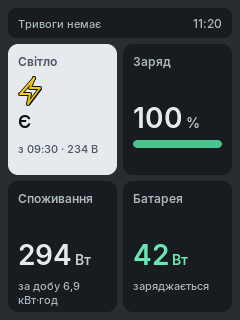
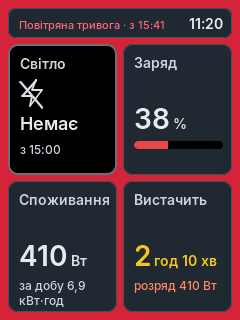

# deye-mini-display

Автономне міні-табло для гібридних інверторів **Deye** з Wi-Fi-логером **Solarman**.
Маленький екран біля ліжка чи на кухні, що показує головне:

- **світло є / немає** (і з котрої години),
- **заряд батареї %** і чи вона заряджається чи розряджається,
- **споживання** квартири,
- **тривогу** у вашій громаді (необов’язково),
- **графік відключень** на другому екрані — Київ (за адресою) і Житомирщина (за чергою), необов’язково.

Без хмари Deye/Solarman, без реєстрацій і токенів: табло читає логер напряму у вашій домашній мережі
й **нічого не записує в інвертор**.

| Світло є | Тривога, світла немає | Налаштування |
| --- | --- | --- |
|  |  |  |

| Графік відключень (свайп) |
| --- |
|  |

> Статус: **0.2.0, перевіряється на залізі.** Деталі — [`docs/PLAN.md`](docs/PLAN.md).

## Що потрібно

- Гібридний інвертор Deye (однофазний, серія SG0xLP1) з Wi-Fi-логером Solarman, що відповідає на локальному порту 8899.
  Трифазні моделі поки не підтримуються — табло так і напише.
- Плата **NiceMCU-32S-DEV 2.8IPS** (ESP32 + екран 2,8″ 240×320 із сенсором, USB-C).
- Wi-Fi 2,4 ГГц у тій самій мережі, що й логер.
- Серійний номер логера (на наклейці логера, «SN»), якщо табло не знайде логер само.

## Встановлення

Поки — через [PlatformIO](https://platformio.org/) (сторінка встановлення з браузера буде пізніше):

```
pio run -e board -t upload
```

1. Після прошивки на табло з’явиться QR-код мережі **Deye-Setup** — наведіть на нього камеру телефона.
2. Сторінка налаштування відкриється сама (або відкрийте `http://192.168.4.1`): виберіть домашній Wi-Fi,
   введіть серійний номер логера, (за бажанням) громаду для тривог і графік відключень.
3. «Зберегти й запустити» — табло перезапуститься й покаже дані.

Змінити налаштування: утримувати кнопку **BOOT** 5 секунд. Журнал роботи: `http://<адреса табло>/log`.

Пароль Wi-Fi зберігається в пам’яті плати незашифрованим (як у більшості таких пристроїв).

## Розробка

```
pio test -e native      # тести логіки на ПК
pio test -e render      # рендер екранів на ПК (картинки — у теку з RENDER_DIR)
python tools/gen_web.py # після зміни src/web/setup.html — оновити src/web_assets.h
```

Перевірка USB-зв’язку плати (бувають браковані): `tools/check_board.bat`.

## Ліцензія

MIT — див. [`LICENSE`](LICENSE). Шрифт Inter — SIL OFL (`src/fonts/Inter-LICENSE.txt`).
